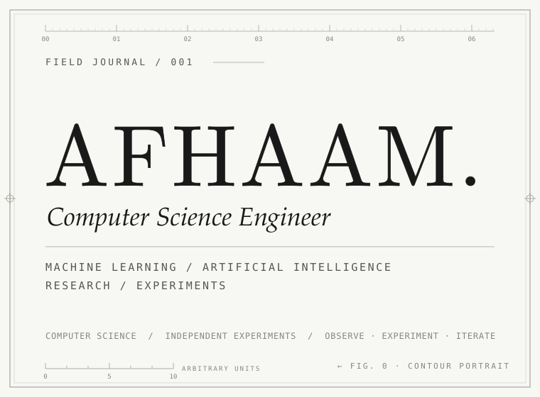
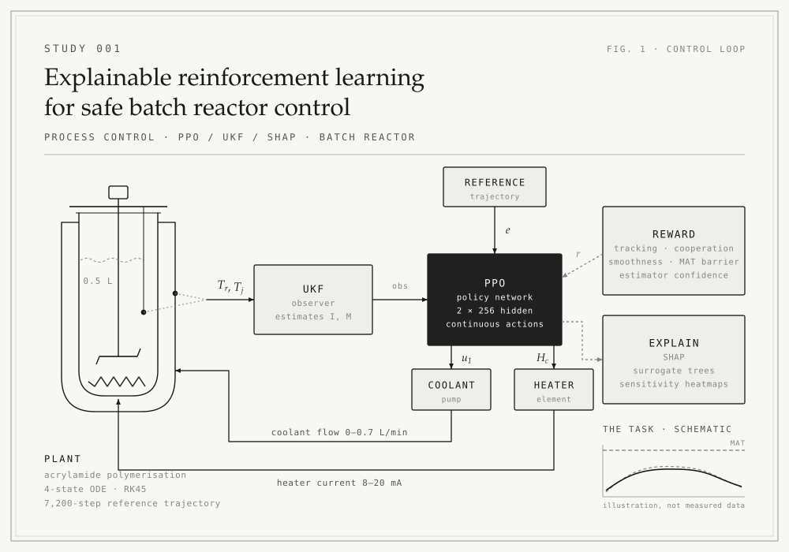
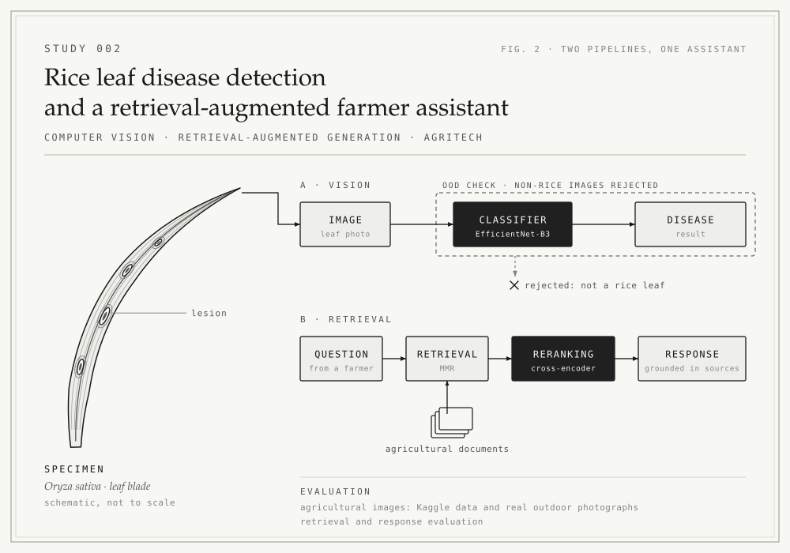
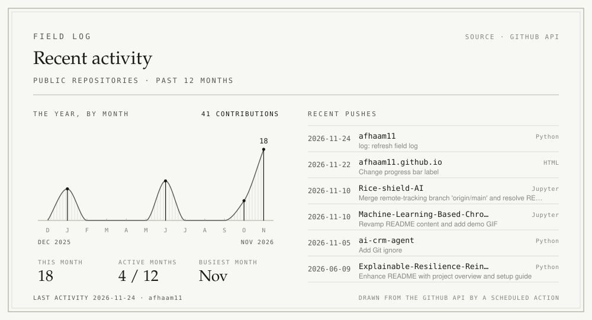

<picture><source media="(prefers-color-scheme: dark)" srcset="assets/contour-portrait-dark.gif"></picture><picture><source media="(prefers-color-scheme: dark)" srcset="assets/field-cover-dark.svg"><source media="(prefers-color-scheme: light)" srcset="assets/field-cover.svg"></picture>

**Afhaam Asief Ali Muhammed** · Computer Science Engineer 
[Website](https://afhaam11.github.io/) · [LinkedIn](https://www.linkedin.com/in/muhammed-afhaam-ali-23259b240/) · [Email](mailto:afhaam008@gmail.com) · [All repositories](https://github.com/Afhaam11?tab=repositories)

<picture>
  <source media="(prefers-color-scheme: dark)" srcset="assets/visual-divider-dark.svg">
  
</picture>

## 00 — Field notes

I like understanding what happens underneath the interface: what the model is actually doing, where its assumptions break, and whether the result is useful outside the demo.

I work on machine learning, LLMs and agents, and on reinforcement learning when the thing being controlled has real constraints. I run models locally to learn what fits in VRAM and what quantization quietly costs, test ideas on real hardware when I can, and treat evaluation as part of the build rather than the paperwork after it. I keep entering hackathons because a deadline and a stranger using the thing are the quickest honest tests I know.

<picture>
  <source media="(prefers-color-scheme: dark)" srcset="assets/visual-divider-dark.svg">
  
</picture>

## 01 — Selected experiments

*Three investigations, each drawn as a plate. The repositories hold the code.*

### Study 001 — Explainable reinforcement learning for safe batch reactor control
`RESEARCH / REINFORCEMENT LEARNING / PROCESS CONTROL`

<picture>
  <source media="(prefers-color-scheme: dark)" srcset="assets/reactor-study-dark.svg">
  <source media="(prefers-color-scheme: light)" srcset="assets/reactor-study.svg">
  
</picture>

A PPO agent learns to run a jacketed acrylamide polymerisation reactor, a 0.5 L plant model with four states integrated with RK45, by adjusting heater current and coolant flow. It never sees the concentrations directly: an unscented Kalman filter estimates monomer and initiator from reactor and jacket temperature, and the policy acts on that estimate and on its tracking error against a reference trajectory. The reward is built around tracking, smooth actuation and a barrier at the maximum allowable temperature, so staying safe is part of what the policy is paid for.

What I care about most is the last step. Afterwards the policy is opened up with SHAP, surrogate decision trees and sensitivity heatmaps, to ask why it heats or cools when it does.

**[Repository →](https://github.com/Afhaam11/Explainable-Resilience-Reinforcement-Learning-on-Lab-Scale-Batch-Reactor-Machine-Learning-Approach)**

### Study 002 — Rice leaf disease detection and a RAG farmer assistant
`COMPUTER VISION / RETRIEVAL-AUGMENTED GENERATION / AGRITECH`

<picture>
  <source media="(prefers-color-scheme: dark)" srcset="assets/rice-study-dark.svg">
  <source media="(prefers-color-scheme: light)" srcset="assets/rice-study.svg">
  
</picture>

Two systems that share a field. The first takes a photo of a rice leaf and names the disease with an EfficientNet-B3 classifier; an out-of-distribution check around that stage rejects photos that aren't rice leaves, because a classifier forced to name a disease for a picture of a shoe isn't being helpful. The second answers a farmer's question from agricultural documents: it retrieves candidates with maximal marginal relevance (so the top results aren't five copies of the same paragraph), reranks them with a cross-encoder, and writes an answer grounded in what it retrieved.

Evaluated on Kaggle images and on real outdoor photographs; retrieval and responses were both evaluated.

**[Repository →](https://github.com/Afhaam11/Rice-shield-AI)**

### Study 003 — Northstar CRM AI, an agent for customer spreadsheets
`LLM APPLICATION / AGENT WORKFLOW / DATA ANALYTICS`

<picture>
  <source media="(prefers-color-scheme: dark)" srcset="assets/crm-study-dark.svg">
  <source media="(prefers-color-scheme: light)" srcset="assets/crm-study.svg">
  
</picture>

Northstar turns a customer spreadsheet into something you can talk to. Upload an Excel or CSV file, ask questions in plain language, and inspect the matching records. The interesting part is what the model is not allowed to do: it never writes SQL. It returns a structured JSON query plan from a small vocabulary (four operations and 27 filter operators), the application checks that plan against the spreadsheet's real columns, and Python builds a parameterized, SELECT-only DuckDB query from it.

Campaigns follow the same caution. The model drafts a subject and body with placeholders, every recipient's final email can be previewed, and nothing is sent until you approve it. Uploads, questions and campaign events are all written to an audit log.

Built with FastAPI, DuckDB, LangChain with a Groq-hosted model, and React; deployed with Vercel and Render.

**[Repository →](https://github.com/Afhaam11/ai-crm-agent)**

<picture>
  <source media="(prefers-color-scheme: dark)" srcset="assets/visual-divider-dark.svg">
  
</picture>

## 02 — The workbench

| Purpose | In use |
|:--|:--|
| **Languages** | Python · SQL · JavaScript |
| **Machine learning** | PyTorch · scikit-learn · XGBoost · SHAP · EfficientNet |
| **Data science** | pandas · NumPy · Matplotlib · Seaborn · Jupyter · Power BI · Tableau · Superset |
| **AI systems** | LangChain · retrieval with MMR and cross-encoder reranking · FastAPI · DuckDB · hosted LLMs (Groq) |
| **Tools** | Git · GitHub · VS Code · Streamlit · React |
| **Infrastructure** | Docker · Vercel · Render |

## 03 — Current investigations

*Open notebooks: things I'm testing or reading about, not things I've finished.*

**N.01 — Local models on real hardware** · `EXPLORING` 
What fits in VRAM, what quantization quietly costs, how fast it actually runs, and where a smaller model is simply the better engineering choice.

**N.02 — Agents that finish the job** · `EXPLORING` 
Agent architectures, tool calling and workflow automation: what separates an agent that demos well from one that does something useful twice in a row. [Northstar CRM AI](https://github.com/Afhaam11/ai-crm-agent) is one small working answer.

**N.03 — When a model should say no** · `EXPLORING` 
Evaluation and reliability: rejecting what is out of distribution (Study 002 does a version of it), grounding answers in sources, and telling a model that is right from one that is only confident.

<picture>
  <source media="(prefers-color-scheme: dark)" srcset="assets/visual-divider-dark.svg">
  
</picture>

## 04 — Activity log

<picture>
  <source media="(prefers-color-scheme: dark)" srcset="assets/activity-log-dark.svg">
  <source media="(prefers-color-scheme: light)" srcset="assets/activity-log.svg">
  
</picture>

*The window is redrawn from the GitHub API by a scheduled action, so it shows only what is actually there. Below it, an index of the public work.*

- `001` **[Explainable RL for safe batch reactor control](https://github.com/Afhaam11/Explainable-Resilience-Reinforcement-Learning-on-Lab-Scale-Batch-Reactor-Machine-Learning-Approach)** — research · Python, PyTorch, PPO, UKF, SHAP
- `002` **[Rice leaf disease detection and RAG assistant](https://github.com/Afhaam11/Rice-shield-AI)** — computer vision, retrieval · EfficientNet-B3, MMR, cross-encoder reranking
- `003` **[Northstar CRM AI](https://github.com/Afhaam11/ai-crm-agent)** — LLM application · FastAPI, DuckDB, LangChain, React
- `004` **[Chronic kidney disease prediction](https://github.com/Afhaam11/Machine-Learning-Based-Chronic-Kidney-Disease-Prediction-System)** — machine learning · scikit-learn, XGBoost, Streamlit
- `005` **[E-commerce customer segmentation](https://github.com/Afhaam11/PowerBi-Projects/tree/main/Customer%20Segementation%20Project)** — analytics · SQL, K-Means, PCA, Power BI

Also in the log, 2025: MITE Ideathon (runners-up), Smart India Hackathon, Prompt Wars (2nd place). The rest is in [all repositories](https://github.com/Afhaam11?tab=repositories).

## 05 — Closing note

Congratulations, you scrolled to the bottom of a GitHub README. Statistically, you're the only one. Hi.

Yes, that's me in the header, staring off to the right like I'm waiting for someone to ask about quantization. Nobody has. Please ask me about quantization.

Meanwhile, a bot redraws my activity log every day while I sleep. It works harder than I do and has never once asked about a hackathon.

Anyway, I build models that are right, not just confident, and I'd like to build one with you. [Email me](mailto:afhaam008@gmail.com) before the page runs out.
